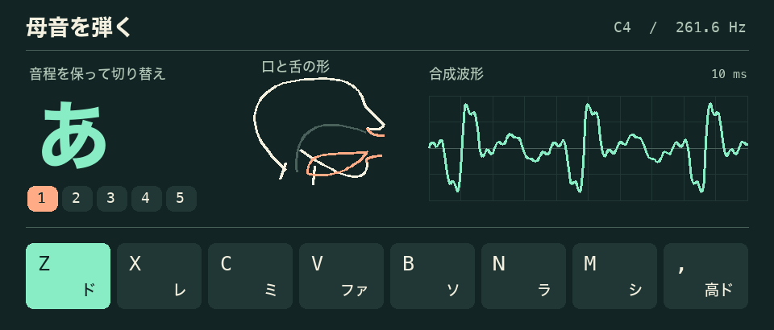
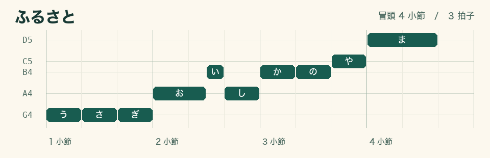

# Cardputer Voice

M5Stack Cardputer-Adv を、かなで歌う単音のUSB-MIDI楽器にするファームウェアです。本体の鍵盤だけで母音を弾けます。Macから歌詞とメロディーを送ると、音符に合わせてM5の中の声帯・声道モデルが歌います。画面には声帯の動きと出力波形が表示されます。

本作の着想の原点は **Jameson Hodge さんの「CHIMERA」** です。その作品から生まれた「声道シミュレータ日本語版」の五母音と口の形を、Cardputer-Advで弾ける楽器にしました。[原作者](https://github.com/jamesondh) · [CHIMERAの原作リポジトリ](https://github.com/jamesondh/chimera-vocal-synth) · [声道シミュレータ日本語版](https://github.com/UMEBOSHIISAN/vocal-tract-synth-ja)



Zでドを伸ばしたまま、1〜5で「あいうえお」を切り替えます。図の波形はファームウェアの合成コードが出力した10ミリ秒分のサンプル、口と舌は本体画面の描画データを使っています。[図の出典](THIRD_PARTY.md#readmeの図と接続)

**対応機種**　Cardputer-Adv（ESP32-S3、8 MB）。付属の再生ツールは macOS 13 以降の Apple Silicon / Intel Mac 用です。

[v1.0.0 の配布ZIP・チェックサムをダウンロード](https://github.com/UMEBOSHIISAN/cardputer-voice/releases/tag/v1.0.0)

配布ZIPには、「あいうえお」で口と波形が動くGIF、『ふるさと』冒頭4小節の図、USB-MIDIと3.5 mmアウトの接続図が入っています。ZIPを展開すると、同梱のREADMEで3点ともオフラインで見られます。

## 実機確認（2026年11月19日）

GitHubで公開した `Cardputer-Voice-1.0.0.zip` のファームウェアをCardputer-Advに書き込み、ハッシュの一致を確認しました。同じZIPに入っている `mac/ふるさとを歌う.command` をMacで実行し、USB-MIDI経由で本体が『ふるさと』全3番（48小節、約1分48秒）を最後まで歌うのを耳で確認しました。



同梱MIDIの冒頭4小節です。横は時間、縦は音の高さ。最初の「う・さ・ぎ」は同じソを3回弾き、音符ごとに歌詞だけが進みます。[同梱MIDI](mac/ふるさと.mid) · [洗足学園音楽大学「教職ピアノ実習」参照譜](https://www.senzoku.ac.jp/music/career/pdf/score_furusato.pdf)

## 最初の一曲

すでに本体が「Cardputer Voice」として起動する場合はここから始めてください。新しい本体には次の節の手順でインストールします。

1. 配布ZIPを展開し、データ通信対応USBケーブルで本体とMacをつなぎます。
2. 本体の下段で **Z X C V B N M ,** を押すとドレミファソラシド。Zを押したまま **1 2 3 4 5** を順に押すと、同じ音程で「あいうえお」が聴けます。
3. 展開したフォルダの **mac/ふるさとを歌う.command** を開きます。全3番、約1分48秒。歌詞も自動で切り替わります。「さくらさくら」と「君が代」にも専用の再生ファイルがあります。
4. 音はM5のスピーカーまたは3.5 mmヘッドホン出力から出ます。録音するときは3.5 mm出力をオーディオインターフェースにつなぎ、入力ゲインを小さくしてから合わせてください。

macOSで配布ファイルの実行確認が出た場合は入手元とチェックサムを確認してください。付属バイナリはアドホック署名です。Developer IDによる公証は行っていません。ソース版は下記の手順でビルドできます。

## ブラウザでインストール

今の本体の内容を残したい場合は、先に次の節でバックアップを取ります。書き込みはCardputer-Adv用です。

1. MacのChromeまたはEdgeで [Espressif公式のESP Tool](https://espressif.github.io/esptool-js/) を開きます。
2. 本体のG0を押したままRSTを押して離し、1秒後にG0を離します。画面が暗くなったら、ページの **Program** で接続し、本体のシリアルポートを選びます。
3. Flash Address を **0x0**、ファイルを **firmware/Cardputer-Voice-Adv.bin** に設定します。**Erase all** はオフ、Flash Mode / Frequency / Size は **Keep** で書き込みます。
4. 完了後にRSTを押し、Zを押すと「ド」が鳴ります。

## バックアップとターミナルからのインストール

書き込むと現在のアプリとパーティション構成が置き換わります。以下はMacのターミナル用です。まず展開した配布フォルダに移動してファイルを確認し、Python 3の仮想環境にesptoolを用意します。

```sh
shasum -a 256 -c SHA256SUMS
python3 -m venv .flash-venv
.flash-venv/bin/python -m pip install esptool==4.11.0
```

1. USB接続したまま **G0** を押し、**RST** を一度押して離します。1秒後にG0を離すと書き込みモードになります。
2. `ls /dev/cu.usbmodem*` で対象ポートを確認します。下の `PORT` を実際の名前に置き換えて実行します。**バックアップ名には新しいファイル名を指定してください。** `flash_id` の検出結果がESP32-S3、8 MBであることを確認します。

```sh
PORT=/dev/cu.usbmodemXXXX
ESP=.flash-venv/bin/esptool.py
"$ESP" --chip esp32s3 --port "$PORT" flash_id
```

3. もう一度書き込みモードに入り、現在の8 MBを丸ごと保存します。バックアップを自分の手元に保管してください。

```sh
"$ESP" --chip esp32s3 --port "$PORT" --after no_reset read_flash 0 0x800000 my-cardputer-backup.bin
wc -c my-cardputer-backup.bin    # 8388608 bytes
shasum -a 256 my-cardputer-backup.bin
```

4. バックアップの完了を確認してから、同梱の4ファイルを書き込みます。

```sh
"$ESP" --chip esp32s3 --port "$PORT" --baud 115200 write_flash \
  0x0000 firmware/bootloader.bin 0x8000 firmware/partitions.bin \
  0xe000 firmware/boot_app0.bin 0x10000 firmware/firmware.bin
```

esptoolのハッシュ検証が終わったらRSTを押し、「最初の一曲」に進みます。元の状態に戻す場合は同じ本体を書き込みモードに入れ、同じポートで `"$ESP" --chip esp32s3 --port "$PORT" write_flash 0 my-cardputer-backup.bin` を実行します。[esptoolの公式手引き](https://docs.espressif.com/projects/esptool/en/release-v4/esp32s3/esptool/basic-commands.html)

## 自分の歌詞を演奏する


**mac/歌詞を送る.command** に「かえるのうた」と入力します。DAWで外部MIDI出力に **Cardputer Voice**、チャンネル **1** を選び、付属の「かえるのうた.mid」を再生すると、6音に「か・え・る・の・う・た」が乗ります。USBはMIDI用、オーディオの録音先は本体のアナログ出力です。

| 操作 | 動作 |
|---|---|
| Note On / Off（36〜96） | 半音単位。1音で1モーラ進み、同時に押した音は後着を優先 |
| CC20 | 発音中の母音を変更。あ・い・う・え・おの代表値は 0 / 32 / 64 / 96 / 127 |
| CC21 ≥ 64 | 次のノートで歌詞の先頭に戻る |
| Velocity / CC11 | 発音の強さ / エクスプレッション |
| Pitch Bend / CC1 | ±2半音 / ビブラートの深さ |

歌詞は1回96モーラまで。長い曲は『ふるさと』のように途中で次の歌詞を送れます。DAWがSysExを読み飛ばす場合は、同梱の再生ファイルで歌詞込みの演奏を確認できます。[演奏方法とMIDI実装](mac/演奏方法.md)

## ソースからビルド

Gitリポジトリではルート、配布ZIPでは `source/` が作業ディレクトリです。ファームのビルドにはPython 3、Git、PlatformIO Core、MacツールとテストにはXcode Command Line Tools（Swift、C++）を使用します。初回のビルドで固定版の依存ライブラリを取得します。

```sh
python3 -m venv .venv
. .venv/bin/activate
python -m pip install platformio==6.2.0 esptool==4.11.0 intelhex==2.3.0
make firmware       # .pio/build/cardputer_adv/firmware.bin
make mac            # mac/voice-midi をこのMac用にビルド
make test           # USB接続不要
make release        # Macで実行。dist/ に配布ZIPとSHA-256を作成
```

`src/` が合成・画面・鍵盤・USB-MIDI、`mac/` が歌詞転送・曲データ、`tests/` がホスト上の検証です。ビルド設定は `platformio.ini` にあります。[PlatformIOのビルドコマンド](https://docs.platformio.org/en/latest/core/userguide/cmd_run.html)

## Special Thanks

この楽器の出発点は「声道シミュレータ日本語版」です。そこで使われている日本語五母音の共鳴周波数をM5の歌声に、母音ごとの顎・唇・舌の位置を本体の画面に受け継ぎました。[UMEBOSHIISAN / vocal-tract-synth-ja](https://github.com/UMEBOSHIISAN/vocal-tract-synth-ja)

そして、日本語版を作るきっかけになった **Chimera Vocal Synth** の作者、**Jameson Hodge さん**に感謝します。声の仕組みを自分の手で演奏するという着想が、ブラウザからこの小さなハードウェア楽器につながりました。[Jameson Hodge / Chimera Vocal Synth](https://github.com/jamesondh/chimera-vocal-synth)

## 参考資料とライセンス

[図と接続の根拠](THIRD_PARTY.md#readmeの図と接続)、[4曲の出典](THIRD_PARTY.md#デモ曲)、[ライブラリとフォントのクレジット](THIRD_PARTY.md#ライブラリフォント) をまとめています。配布ZIPにはプロジェクトのソースと、使用したArduinoコアのソースも同梱しています。
